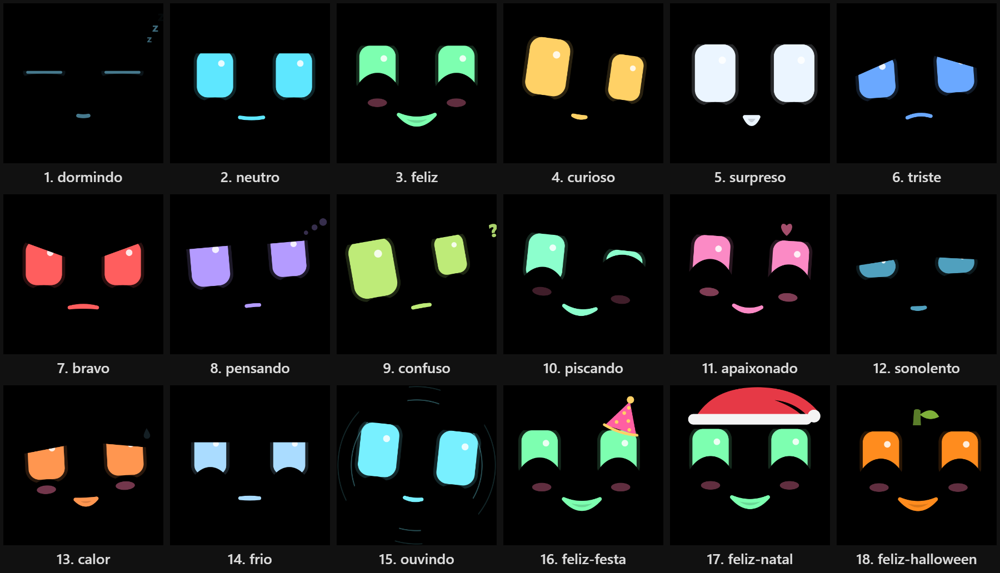

# Pet Face

Um tablet velho virou um pet que mora na sala: um rosto animado em tela cheia que reage à casa pelo [Home Assistant](https://www.home-assistant.io/). Ele percebe quando alguém chega, conversa por voz em português, acende a luz, liga a TV, avisa se vai chover, gosta de carinho na tela e dorme à noite.



<!-- Coloque aqui um GIF curto do pet:  -->
<!-- Vídeo: [Veja o pet em ação](https://youtube.com/...) -->

## O que ele faz
- **Rosto com humor:** 15 expressões (feliz, surpreso, curioso, pensando, confuso, piscando, apaixonado, sonolento, triste, bravo, com calor, com frio, dormindo, ouvindo, neutro), enfeites de festa, Natal e Halloween, e boca animada com legenda quando fala.
- **Reação passageira:** a emoção da conversa ou do carinho dura alguns segundos e o rosto volta sozinho ao humor de base.
- **Conversa por voz** pelo Assist do HA ("Ok Nabu"), com personalidade definida num prompt em português e emoção tirada da própria fala. Enquanto pensa, mostra o que entendeu da frase (linha "entendi").
- **"O que você está vendo?":** manda uma foto da câmera da sala para a IA e descreve o que vê (só quando pedem; a foto não é salva).
- **Ajusta o próprio tablet:** "fala mais baixo", "fica mudo", "diminui o brilho".
- **Percebe presença** por sensores de movimento ou pelo rosto na câmera do tablet, e cumprimenta.
- **Ajuda na casa:** porta aberta, campainha, chuva chegando, luz acesa de dia, bateria do tablet, "boa noite" que desliga tudo.
- **Cuida de quem está no PC:** lembra de beber água, alongar e descansar os olhos ([docs/PC.md](docs/PC.md)).
- **Modo demo:** "Ok Nabu, modo demo" apresenta tudo em 2 minutos.
- **Dorme à noite:** tela quase apagada e fala só na tela.

## Como funciona
Toda a lógica fica no Home Assistant (`ha-package/pet.yaml`: helpers, scripts e automações). A página só exibe o estado de algumas entidades. Assim o pet continua funcionando com a página fechada, e a mesma página serve como cartão do painel do HA (`custom:pet-face-card`) ou como página avulsa.

O que foi usado aqui:
| Parte | Usado neste projeto |
|---|---|
| Tela | Galaxy Tab A7 Lite com Android 14 (qualquer tablet com navegador serve) |
| Voz no tablet | app View Assist Companion (VACA) como satélite do Assist |
| Fala e escuta | HA Cloud (STT) e a voz Leda do Gemini pelo OpenRouter (TTS); o HA Cloud também serve para a fala |
| Conversa | um agente de conversa com LLM no HA (aqui, Claude Haiku pela integração OpenRouter) |
| Tela cheia | Kiosk Mode (HACS) |

## Para montar o seu
1. Instale o pacote e a página: [docs/INSTALL.md](docs/INSTALL.md).
2. Configure a voz e a personalidade: [docs/VOICE.md](docs/VOICE.md).
3. Prepare o tablet: [docs/TABLET.md](docs/TABLET.md).
4. **Adapte o pacote à sua casa.** O `pet.yaml` usa as entidades desta instalação (luzes, TV, porta, câmera, PC, a Bela, o pet de verdade da casa). Troque os IDs pelos seus ou apague as automações que não fazem sentido para você.

Interface e falas em português do Brasil; o código está em inglês.

## Requisitos
Node 22.18 ou mais novo (o mock e os testes rodam TypeScript direto no Node). Use uma pasta local: em unidades do Google Drive, o `npm install` falha.

## Comandos
```bash
npm install
npm run dev        # http://localhost:5173  (painel dev: /?dev=1)
npm run mock       # HA falso em http://localhost:8124 (controle em /mock, token dev-token)
npm test           # testes (rosto, entidades do HA, coerência do pacote HA)
npm run smoke      # sobe o mock e o testa com a biblioteca oficial do HA
npm run build      # gera dist/ (página avulsa + dist/pet-face-card.js) para copiar em /config/www/pet/
```

## Conexão com o HA
Na primeira abertura aparece a tela de setup, com duas opções:
- **Entrar com o Home Assistant** (recomendado): login normal do HA (OAuth). Os tokens se renovam sozinhos.
- **Token de longa duração**: crie em *Perfil → Segurança* de um usuário **sem** permissão de administrador e cole no campo.

As credenciais ficam só no `localStorage` do aparelho. Para trocar a conexão, abra a página com `?setup=1`, use "Configurar" no aviso de offline ou "Trocar conexão" no painel dev.

A página assina só as entidades do pet (não as ~650 da casa). Se o HA cair, o rosto fica triste após 5 s, aparece um aviso discreto no topo e a reconexão é automática. Um ping a cada 30 s detecta conexões mortas sem aviso (Wi-Fi caiu).

Até a Etapa 3 criar os helpers, o rosto conectado ao HA real fica neutro, e o painel dev lista as entidades que faltam.

### Desenvolver com o mock
```bash
npm run mock
npm run dev
```
Abra `http://localhost:5173/?dev=1&config=mock/pet.config.mock.json` e use o token `dev-token`. Em `http://localhost:8124/mock` dá para simular chegada, saída, conversa por voz e queda.

## Painel dev (`?dev=1`)
Força humor, estado do satélite, modo dormir e conexão só na tela local, sem escrever no HA. "Simular conversa" percorre ouvindo → pensando → falando com legenda → parado. Tocar no rosto dá carinho; o contador mostra quantos carinhos seriam enviados ao HA (no máximo um a cada 1,5 s).

## Estrutura
```
src/face/         renderer SVG, expressões e animação
src/state/        store e tradução do estado do HA para o rosto (derive.ts)
src/ha/           autenticação, conexão e leitura das entidades do pet
src/ui/           tela de setup
src/dev/          painel dev
src/i18n/pt-BR.ts textos da interface
mock/             mock do HA (WebSocket) e smoke test
tests/            testes com node:test
ha-package/       pacote do HA (helpers, script e automações do pet)
docs/             INSTALL, VOICE, TABLET, PC
```

## Licença
[MIT](LICENSE)
